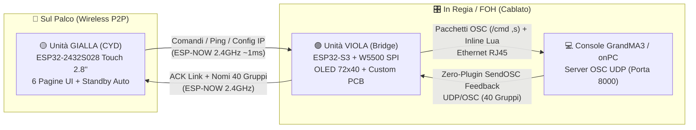

# 🎛️ Portable MAesp32 — Wireless Pocket Remote & Ethernet OSC Bridge for GrandMA3

> 🌐 **Lingua / Language**: **🇮🇹 Italiano** | **[🇬🇧 English](./README_EN.md)**

-brightgreen?style=for-the-badge)


**Portable MAesp32** è un sistema di controllo remoto tascabile, bidirezionale e a bassissima latenza progettato per le console luci **GrandMA3** (e sistemi onPC).  
Permette a Lighting Designer, programmatori e tecnici di palco di puntare i fari (*focusing*), richiamare gruppi, lanciare Cue/Sequenze e gestire Highlight/Solo muovendosi liberamente sul palco **senza bisogno di alcuna rete Wi-Fi esterna o router dedicato**.

---

## ✨ Perché Portable MAesp32?

Durante il *focus* o il *rigging* in teatro, arena o festival, collegare tablet o smartphone via Wi-Fi alla rete di regia presenta tre problemi classici:
1. **Saturazione RF e disconnessioni** quando il locale si riempie o il telefono va in blocco schermo.
2. **Mancanza di tasti rapidi dedicati** con feedback immediato sotto le dita.
3. **Configurazione di rete complessa** (DHCP, access point esterni, indirizzi IP che cambiano).

**Portable MAesp32** risolve tutto dividendo l'architettura in due unità dedicate che parlano tra loro in **ESP-NOW diretto peer-to-peer (~1 ms di latenza)**:
- 🟣 **Unità VIOLA (Bridge Ethernet <-> ESP-NOW)**: rimane in regia o vicino allo switch di rete, collegata via cavo RJ45 Ethernet alla console **GrandMA3** su PCB custom dedicata (`ESP_ETH`).
- 🟡 **Unità GIALLA (Controller Touch CYD)**: telecomando tascabile basato su **ESP32-2432S028** con display touch TFT da 2.8" (320×240), LED RGB di stato e 6 schermate operative.

---

## 🏗️ Architettura del Sistema



---

## 📂 Struttura del Repository

```text
portable MAesp32/
├── README.md                                 # Documentazione tecnica e guida d'uso
├── PRESENTATION.md                           # Presentazione del progetto per GitHub / Showcase
├── LICENSE                                   # Licenza Open Source MIT
├── firmware/
│   ├── MA3_ESPNOW_VIOLA_V3/
│   │   └── MA3_ESPNOW_VIOLA_V3.ino           # Firmware Bridge (ESP32-S3 + W5500 + OLED 72x40)
│   └── MA3_ESPNOW_CYB_V3/
│       └── MA3_ESPNOW_CYB_V3.ino             # Firmware Controller Touch (ESP32-2432S028 CYD)
└── hardware/
    ├── kicad/                                # Progetto KiCad 9.0 completo + modelli 3D (.step / .3mf)
    │   ├── ESP_ETH.kicad_pro
    │   ├── ESP_ETH.kicad_sch
    │   ├── ESP_ETH.kicad_pcb
    │   ├── ESP_ETH.3mf
    │   └── ESP_ETH.step
    └── gerber/                               # File Gerber pronti per la produzione (JLCPCB / PCBWay)
        ├── ESP_ETH_Gerber.zip
        └── *.gbr / *.gbrjob
```

---

## 🖥️ Le 6 Pagine dell'Unità GIALLA (Controller CYD)

| Pagina | Nome | Funzioni e Scorciatoie |
| :---: | :--- | :--- |
| **P1** | **Tastierino Canali** | Tastierino numerico completo (`0–9`, `.`, `+`, `Thru`, `At`, `CLR`, `PLEASE`).<br>• **Doppio Tap su `+`**: invia subito `At Percent + 10`<br>• **Doppio Tap su `At`**: invia subito `<Selezione> At Normal` (Full/Normal)<br>• **Doppio Tap su `.`**: invia subito `<Selezione> At 0` |
| **P2** | **Utility & Focus** | Tasti rapidi giganti per il puntamento luci:<br>• `NEXT` / `PREV` per scorrere le fixture<br>• `HIGHLIGHT` (toggle On/Off con stato visivo arancione)<br>• `SOLO` (toggle On/Off con stato visivo blu)<br>• `CLEAR` immediato |
| **P3** | **Cue & Sequence** | Tastierino dedicato al playback: `GOTO`, `CUE`, `SEQ`, `0–9`, `.`, `CLR`, `PLEASE`. |
| **P4** | **Database 40 Gruppi** | Griglia paginata per **40 Gruppi** (`6` per schermata, scorrimento `<<` e `>>`).<br>• Tasto **`SYNC NAMES` (Zero-Plugin!)**: il Bridge inietta direttamente via `/cmd` uno script **Inline Lua** a 8 micro-batch su GrandMA3, auto-configura l'IP di ritorno OSC e riceve in tempo reale i veri nomi dei 40 gruppi dalla console **senza dover installare alcun plugin nello showfile**! |
| **P5** | **Rete & IP Remoto** | Configurazione diretta di **Local IP (Bridge)**, **Target IP (MA3)** e **OSC Port**.<br>• Supporta **Auto-Repeat accelerato** tenendo premuto `+` o `-`.<br>• Premendo **`SAVE SETTINGS`**, salva in NVS e aggiorna via radio anche il Bridge Viola! |
| **P6** | **Backlight & Power** | Regolazione della luminosità del display su **10 livelli (`0% – 100%`)** salvata in memoria NVS.<br>• **Standby automatico dopo 30s** di inattività (0% consumi backlight) con risveglio al primo tocco (senza premere tasti per errore). |

---

## 🔌 Hardware & Pinout

### 1. Unità VIOLA — Bridge Ethernet (`ESP32-S3 + W5500 + OLED 0.42"`)
Realizzata su **PCB custom dedicata** (file KiCad e Gerber inclusi in [`hardware/`](./hardware)).

| Componente / Segnale | Pin ESP32-S3 | Note Tecniche |
| :--- | :---: | :--- |
| **W5500 SPI SCK** | `GPIO 4` | Clock bus SPI Ethernet |
| **W5500 SPI MISO** | `GPIO 1` | Master In Slave Out |
| **W5500 SPI MOSI** | `GPIO 7` | Master Out Slave In |
| **W5500 SPI CS (SCS)** | `GPIO 3` | Chip Select Ethernet |
| **OLED 72×40 I2C SCL** | `GPIO 6` | Display integrato SSD1306 (Full-Buffer `_F_`) |
| **OLED 72×40 I2C SDA** | `GPIO 5` | Display integrato SSD1306 |
| **Tasto Pagina OLED** | `GPIO 9` | Tasto `BOOT` integrato (cicla tra `BR-IP`, `MA-IP`, `PORT`, `CYB-STAT`) |

### 2. Unità GIALLA — Controller Touch (`ESP32-2432S028 CYD`)
Nessuna saldatura richiesta: utilizza la scheda standard *Cheap Yellow Display* da 2.8".

| Periferica CYD | Pin ESP32 | Note Tecniche |
| :--- | :---: | :--- |
| **Touch XPT2046 SPI** | `CLK 25`, `MISO 39`, `MOSI 32` | Bus `VSPI` dedicato al controller touch resistivo |
| **Touch CS / IRQ** | `CS 33`, `IRQ 36` | Chip Select e Interrupt Touch |
| **Backlight PWM** | `GPIO 21` | Controllo PWM a 10 livelli + spegnimento Standby |
| **LED RGB Onboard** | `R: 4`, `G: 16`, `B: 17` | Feedback luminoso non bloccante (Active-Low) |

---

## 🛠️ Produzione PCB (`hardware/`)

Nella cartella [`hardware/`](./hardware) trovi tutto il necessario per produrre la scheda **ESP_ETH** dell'unità Bridge:
- **Gerber pronti per la stampa**: carica direttamente [`hardware/gerber/ESP_ETH_Gerber.zip`](./hardware/gerber/ESP_ETH_Gerber.zip) su **JLCPCB**, **PCBWay** o **Aisler** (2 layer standard, spessore 1.6 mm, finitura HASL/ENIG).
- **Sorgenti KiCad 9.0**: schema elettrico ([`ESP_ETH.kicad_sch`](./hardware/kicad/ESP_ETH.kicad_sch)) e layout PCB ([`ESP_ETH.kicad_pcb`](./hardware/kicad/ESP_ETH.kicad_pcb)).
- **Modelli 3D**: file [`ESP_ETH.step`](./hardware/kicad/ESP_ETH.step) e [`ESP_ETH.3mf`](./hardware/kicad/ESP_ETH.3mf) per progettare o stampare in 3D un case su misura.

---

## 🚀 Configurazione su GrandMA3

1. **Collegamento di Rete**:
   - Collega l'unità **VIOLA** via cavo Ethernet allo stesso switch della console GrandMA3 (o del PC con GrandMA3 onPC).
   - Dalla **Pagina 5** dell'unità **GIALLA**, imposta:
     - `LOCAL IP (BRIDGE)`: un IP libero nella sottorete di MA3 (es. `192.168.1.100`)
     - `TARGET IP (MA3)`: l'IP della console GrandMA3 (es. `192.168.1.223`)
     - `OSC PORT`: `8000` (o la porta impostata su MA3)
   - Premi **`SAVE SETTINGS`**: il Bridge salverà i parametri in memoria permanente e si riavvierà con il nuovo IP.

2. **Abilitazione OSC su GrandMA3**:
   - Vai in **Menu → In & Out → OSC**.
   - Nella riga **OSCData 1**, imposta:
     - **Destination IP**: `192.168.1.100` *(IP del Bridge Viola)*
     - **Mode**: `UDP`
     - **Port**: `8000`
     - **Receive**: `Yes`
     - **Receive Command**: `Yes`
     - **Send**: `Yes`
     - **Enabled**: `Yes`

3. **Sincronizzazione 40 Gruppi "Zero-Plugin" & Auto-Creazione Riga OSC Non Distruttiva**:
   - **Non serve creare o importare alcun Plugin nello showfile di GrandMA3, né rischiare di sovrascrivere linee OSC già usate (es. QLab, Companion, Timecode)!**
   - Quando premi **`SYNC NAMES`** nella **Pagina 4** del controller tascabile:
     1. **Auto-Discovery / Append Non Distruttivo (`_G.MAESP`)**: il Bridge **VIOLA** invia un comando `Lua "..."` inline su `/cmd` che scansiona `ShowData().OSCBase`:
        - Se trova già una riga chiamata **`MAesp32`** (o che punta già all'IP del Bridge), **riusa quella riga** senza creare duplicati.
        - Se `OSC 1`, `OSC 2`, ecc. sono già occupate da altri sistemi, **non le tocca**: chiama `:Append()` creando una **nuova riga dedicata in coda** chiamata **`MAesp32`** con `DestinationIP` = IP del Bridge, `Port` = porta configurata e `Send = Yes`, salvandone l'indice in `_G.MAESP`.
     2. **Scansione a 8 Micro-Batch**: subito dopo, il Bridge interroga `DataPool().Groups[1..40]` in **8 micro-batch da 5 gruppi ogni 75 ms** inviando `SendOSC <_G.MAESP>` verso la riga dedicata appena trovata/creata.
     3. I primi 40 gruppi dello showfile compaiono in meno di mezzo secondo sui pulsanti touch del palmare!

---

## ⚙️ Miglioramenti Tecnici della Versione V3 PRO

- **Coda FreeRTOS Thread-Safe (`rxQueue`)**: sull'unità Viola la ricezione radio ESP-NOW (`OnDataRecv`, Core 0) è completamente disaccoppiata dal bus SPI del modulo Ethernet W5500 (Core 1), eliminando qualsiasi rischio di collisione SPI durante il traffico bidirezionale simultaneo.
- **Display OLED Full-Buffer (`_F_`) non bloccante**: il display 72×40 della Viola viene aggiornato in RAM (360 byte) e inviato via I2C ogni 60 ms senza cicli `firstPage()/nextPage()` né `delay()`, lasciando la CPU libera al 99% per processare raffiche di pacchetti UDP da MA3.
- **Zero Frammentazione Heap**: sostituiti gli array dinamici `String` dei 40 gruppi con buffer statici pre-allocati (`char groupNames[40][20]`) e parsing `char*` in `OnDataRecv` senza alcun `delay()`.
- **Touch State Machine + Auto-Repeat**: rilevamento sul fronte di salita del tocco (niente più tocchi multipli involontari tenendo premuto il dito), doppi click rapidi su `+` / `At` / `.` e scorrimento veloce tenendo premuto `+` o `-` nella configurazione IP/Porta.
- **Ridisegno Parziale Flicker-Free**: nella Pagina 5 (IP/Porta) e Pagina 6 (Backlight) vengono ridisegnate solo le caselle numeriche modificate, eliminando lo sfarfallio a tutto schermo.
- **Isolamento Salvataggio Luminosità**: la modifica della luminosità salva in NVS solo il parametro locale senza inviare il comando di reboot al Bridge Ethernet.

---

## 👤 Autore & Licenza

Progettato e sviluppato da **Angelo Parlato**.  
Rilasciato sotto licenza [MIT](./LICENSE) — sentiti libero di studiare, costruire e personalizzare il tuo **Portable MAesp32**!
