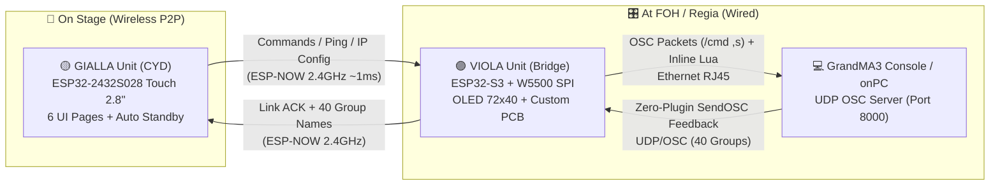

# 🎛️ Portable MAesp32 — Wireless Pocket Remote & Ethernet OSC Bridge for GrandMA3

> 🌐 **Language / Lingua**: **🇬🇧 English** | **[🇮🇹 Italiano](./README.md)**

-brightgreen?style=for-the-badge)


**Portable MAesp32** is a pocket-sized, bidirectional, ultra-low-latency wireless remote control system designed for **GrandMA3** lighting consoles (and onPC systems).  
It allows Lighting Designers, programmers, and stage technicians to focus fixtures, recall groups, trigger Cues/Sequences, and toggle Highlight/Solo while walking freely around the stage **without relying on any external Wi-Fi network or router**.

---

## ✨ Why Portable MAesp32?

During focusing or rigging in theaters, arenas, or festivals, connecting tablets or smartphones via Wi-Fi to the FOH network introduces three classic headaches:
1. **RF congestion and dropped connections** when the venue fills up or the phone screen locks.
2. **Lack of dedicated tactile/quick-access buttons** for rapid one-handed operation on stage or on a ladder.
3. **Complex network setup** (DHCP issues, external access points, changing IP subnets).

**Portable MAesp32** solves this by splitting the architecture into two dedicated hardware units that talk directly to each other via **peer-to-peer ESP-NOW (~1 ms latency)**:
- 🟣 **VIOLA Unit (Ethernet <-> ESP-NOW Bridge)**: sits at FOH or near the network switch, connected via standard RJ45 Ethernet cable to the **GrandMA3** console on a custom-designed PCB (`ESP_ETH`).
- 🟡 **GIALLA Unit (Handheld CYD Touch Controller)**: a pocket remote based on the **ESP32-2432S028** featuring a 2.8" TFT touchscreen (320×240), RGB status LED, and 6 dedicated lighting control pages.

---

## 🏗️ System Architecture



---

## 📂 Repository Structure

```text
portable MAesp32/
├── README.md                                 # Documentazione tecnica in Italiano
├── README_EN.md                              # Technical documentation in English
├── PRESENTATION.md                           # Project showcase & release presentation (IT / EN)
├── LICENSE                                   # MIT Open Source License
├── firmware/
│   ├── MA3_ESPNOW_VIOLA_V3/
│   │   └── MA3_ESPNOW_VIOLA_V3.ino           # Bridge Firmware (ESP32-S3 + W5500 + OLED 72x40)
│   └── MA3_ESPNOW_CYB_V3/
│       └── MA3_ESPNOW_CYB_V3.ino             # Touch Controller Firmware (ESP32-2432S028 CYD)
└── hardware/
    ├── kicad/                                # Complete KiCad 9.0 project + 3D models (.step / .3mf)
    │   ├── ESP_ETH.kicad_pro
    │   ├── ESP_ETH.kicad_sch
    │   ├── ESP_ETH.kicad_pcb
    │   ├── ESP_ETH.3mf
    │   └── ESP_ETH.step
    └── gerber/                               # Production-ready Gerber files (JLCPCB / PCBWay)
        ├── ESP_ETH_Gerber.zip
        └── *.gbr / *.gbrjob
```

---

## 🖥️ The 6 Pages of the GIALLA Unit (CYD Controller)

| Page | Name | Features & Shortcuts |
| :---: | :--- | :--- |
| **P1** | **Channel Keypad** | Full numeric keypad (`0–9`, `.`, `+`, `Thru`, `At`, `CLR`, `PLEASE`).<br>• **Double-Tap `+`**: immediately sends `At Percent + 10`<br>• **Double-Tap `At`**: immediately sends `<Selection> At Normal` (Full/Normal)<br>• **Double-Tap `.`**: immediately sends `<Selection> At 0` |
| **P2** | **Utility & Focus** | Large quick-action buttons for fixture focusing:<br>• `NEXT` / `PREV` to step through fixtures<br>• `HIGHLIGHT` (On/Off toggle with orange visual state)<br>• `SOLO` (On/Off toggle with blue visual state)<br>• Instant `CLEAR` |
| **P3** | **Cue & Sequence** | Dedicated playback keypad: `GOTO`, `CUE`, `SEQ`, `0–9`, `.`, `CLR`, `PLEASE`. |
| **P4** | **40-Group Database** | Paginated grid for **40 Groups** (`6` per view, `<<` and `>>` navigation).<br>• **`SYNC NAMES` Button (Zero-Plugin!)**: the Bridge injects an **Inline Lua** script directly over `/cmd` in 8 micro-batches, non-destructively sets up the return OSC line, and streams the real names of Groups 1–40 from the console **without installing any plugin in the showfile**! |
| **P5** | **Network & Remote IP** | Direct configuration of **Local IP (Bridge)**, **Target IP (MA3)**, and **OSC Port**.<br>• Supports **accelerated Auto-Repeat** when holding down `+` or `-`.<br>• Pressing **`SAVE SETTINGS`** stores parameters in NVS and wirelessly updates/reboots the Viola Bridge! |
| **P6** | **Backlight & Power** | Display brightness control across **10 levels (`0% – 100%`)** saved in NVS.<br>• **Automatic Standby after 30s** of inactivity (0% backlight power) with instant wake-on-touch (first touch wakes the screen without triggering buttons). |

---

## 🔌 Hardware & Pinout

### 1. VIOLA Unit — Ethernet Bridge (`ESP32-S3 + W5500 + 0.42" OLED`)
Built on a **custom-designed PCB** (KiCad and Gerber files included in [`hardware/`](./hardware)).

| Component / Signal | ESP32-S3 Pin | Technical Notes |
| :--- | :---: | :--- |
| **W5500 SPI SCK** | `GPIO 4` | Ethernet SPI Bus Clock |
| **W5500 SPI MISO** | `GPIO 1` | Master In Slave Out |
| **W5500 SPI MOSI** | `GPIO 7` | Master Out Slave In |
| **W5500 SPI CS (SCS)** | `GPIO 3` | Ethernet Chip Select |
| **OLED 72×40 I2C SCL** | `GPIO 6` | Integrated SSD1306 Display (Full-Buffer `_F_`) |
| **OLED 72×40 I2C SDA** | `GPIO 5` | Integrated SSD1306 Display |
| **OLED Page Button** | `GPIO 9` | Onboard `BOOT` button (cycles `BR-IP`, `MA-IP`, `PORT`, `CYB-STAT`) |

### 2. GIALLA Unit — Touch Controller (`ESP32-2432S028 CYD`)
No soldering required: runs out-of-the-box on the standard 2.8" *Cheap Yellow Display* board.

| CYD Peripheral | ESP32 Pin | Technical Notes |
| :--- | :---: | :--- |
| **XPT2046 Touch SPI** | `CLK 25`, `MISO 39`, `MOSI 32` | Dedicated `VSPI` bus for resistive touch controller |
| **Touch CS / IRQ** | `CS 33`, `IRQ 36` | Touch Chip Select and Interrupt |
| **Backlight PWM** | `GPIO 21` | 10-level PWM brightness control + Standby shutoff |
| **Onboard RGB LED** | `R: 4`, `G: 16`, `B: 17` | Non-blocking visual feedback (Active-Low) |

---

## 🛠️ PCB Manufacturing (`hardware/`)

The [`hardware/`](./hardware) folder contains everything needed to manufacture the **ESP_ETH** Bridge board:
- **Production-Ready Gerbers**: upload [`hardware/gerber/ESP_ETH_Gerber.zip`](./hardware/gerber/ESP_ETH_Gerber.zip) directly to **JLCPCB**, **PCBWay**, or **Aisler** (standard 2-layer PCB, 1.6 mm thickness, HASL/ENIG finish).
- **KiCad 9.0 Sources**: schematic ([`ESP_ETH.kicad_sch`](./hardware/kicad/ESP_ETH.kicad_sch)) and PCB layout ([`ESP_ETH.kicad_pcb`](./hardware/kicad/ESP_ETH.kicad_pcb)).
- **3D Models**: [`ESP_ETH.step`](./hardware/kicad/ESP_ETH.step) and [`ESP_ETH.3mf`](./hardware/kicad/ESP_ETH.3mf) files for designing or 3D-printing a custom enclosure.

---

## 🚀 GrandMA3 Setup Guide

1. **Network Connection**:
   - Connect the **VIOLA** unit via Ethernet cable to the same network switch as your GrandMA3 console (or GrandMA3 onPC computer).
   - From **Page 5** on the **GIALLA** handheld unit, set:
     - `LOCAL IP (BRIDGE)`: a free IP address in the MA3 subnet (e.g., `192.168.1.100`)
     - `TARGET IP (MA3)`: your GrandMA3 console IP address (e.g., `192.168.1.223`)
     - `OSC PORT`: `8000` (or the OSC port configured on MA3)
   - Tap **`SAVE SETTINGS`**: the Bridge will save the parameters to non-volatile memory and reboot with the new IP.

2. **Enable OSC Input on GrandMA3**:
   - Navigate to **Menu → In & Out → OSC**.
   - Make sure **Enable Input** (top bar) is active, and on your OSC line set:
     - **Mode**: `UDP`
     - **Port**: `8000`
     - **Receive**: `Yes`
     - **Receive Command**: `Yes`

3. **"Zero-Plugin" 40-Group Sync & Non-Destructive OSC Line Auto-Creation**:
   - **You do NOT need to create or import any Lua Plugin into your GrandMA3 showfile, nor worry about overwriting existing OSC lines (such as QLab, Companion, or Timecode)!**
   - When you press **`SYNC NAMES`** on **Page 4** of the handheld remote:
     1. **Non-Destructive Auto-Discovery / Append (`_G.MAESP`)**: the **VIOLA** Bridge injects an inline `Lua "..."` command over `/cmd` that enables global `EnableOutput` and scans `ShowData().OSCBase`:
        - If a row named **`MAesp32`** (or already pointing to the Bridge IP) exists, it **reuses that row** without creating duplicates.
        - If `OSC 1`, `OSC 2`, etc. are already used by other show systems, **it leaves them completely untouched**: it calls `:Append()` to create a **new dedicated row at the end** named **`MAesp32`** with `DestinationIP` = Bridge IP, `Port` = configured port, and `Send = Yes`, storing its internal MA3 index in `_G.MAESP`.
     2. **8 Micro-Batch Scan**: immediately after, the Bridge queries `DataPool().Groups[1..40]` in **8 micro-batches of 5 groups every 75 ms**, firing `SendOSC <_G.MAESP>` back to the Bridge.
     3. All 40 group names from the showfile populate the touchscreen buttons in about half a second!

---

## ⚙️ V3 PRO Technical Highlights

- **Thread-Safe FreeRTOS Queue (`rxQueue`)**: on the Viola unit, ESP-NOW radio reception (`OnDataRecv`, Core 0) is completely decoupled from the W5500 SPI Ethernet bus (Core 1), eliminating SPI bus collisions during simultaneous bidirectional traffic.
- **Non-Blocking Full-Buffer OLED (`_F_`)**: the 72×40 OLED on the Viola unit uses a 360-byte RAM full buffer refreshed every 60 ms without `firstPage()/nextPage()` loops or blocking `delay()` calls, keeping 99% of CPU time free to drain bursts of UDP packets from MA3.
- **Zero Heap Fragmentation**: dynamic `String` arrays for the 40 groups have been replaced with pre-allocated static buffers (`char groupNames[40][20]`) and fast `char*` parsing inside `OnDataRecv`.
- **Touch Edge-Detection + Auto-Repeat**: rising-edge touch detection prevents accidental double-presses when holding a finger down, enables crisp double-taps on `+` / `At` / `.`, and provides progressive speed auto-repeat when holding `+` or `-` on the IP/Port setup page.
- **Flicker-Free Partial Redraws**: Pages 2, 4, 5, and 6 only redraw the specific buttons or numeric boxes that changed instead of clearing the entire screen with `fillScreen()`.
- **Isolated Brightness Storage**: adjusting backlight levels saves only the local NVS parameter without triggering a network reboot on the Ethernet Bridge.

---

## 👤 Author & License

Designed and developed by **Angelo Parlato**.  
Released under the [MIT License](./LICENSE) — feel free to study, build, and customize your own **Portable MAesp32**!
